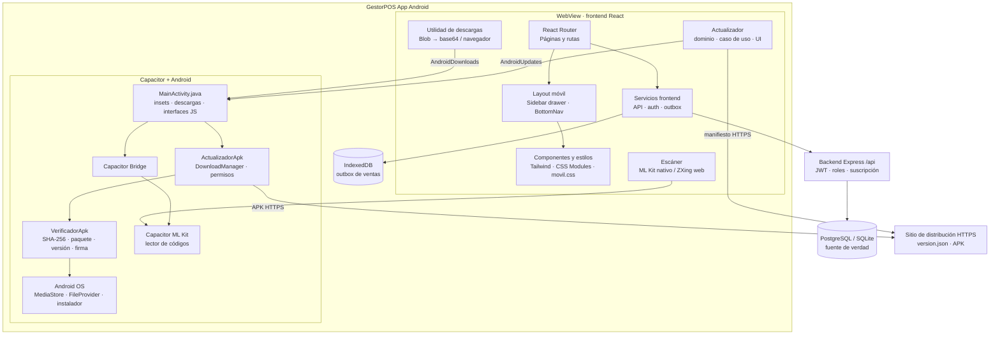
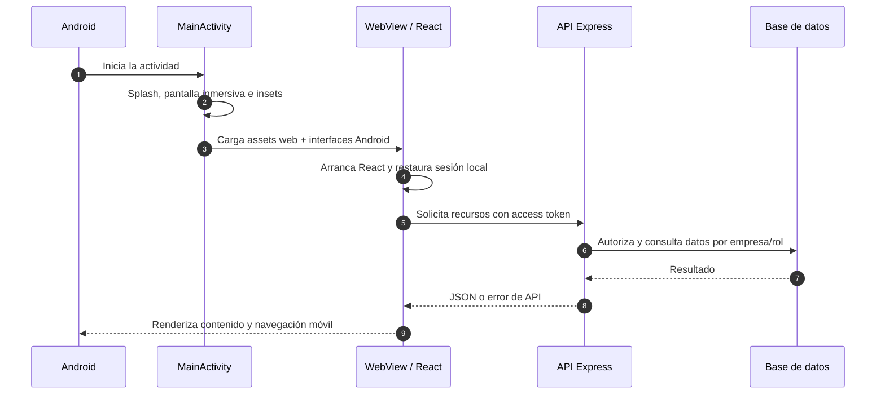
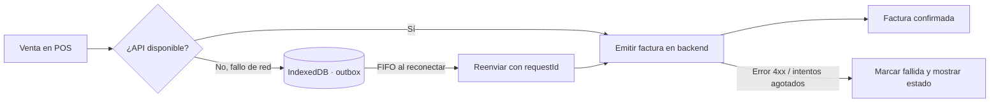

# GestorPOS App móvil — Arquitectura

> Arquitectura de la aplicación móvil de GestorPOS, basada en el estado actual
> del repositorio. La implementación nativa descrita en detalle es Android.

## 1. Alcance y decisiones

GestorPOS móvil no es una segunda aplicación de negocio: reutiliza el frontend
React de la aplicación web y lo distribuye dentro de un WebView administrado por
Capacitor. La interfaz, las rutas, la autenticación y las llamadas al backend
son compartidas. Android añade capacidades del dispositivo mediante plugins de
Capacitor y dos puentes JavaScript propios.

Principios:

- **Una sola UI y lógica de negocio:** React y los servicios web son la base de
  la app instalada.
- **Adaptación móvil, no una UI paralela:** navegación, tablas, formularios,
  áreas seguras y controles táctiles se ajustan al viewport y al dispositivo.
- **Backend como fuente de verdad:** el almacenamiento local se limita a la
  sesión del cliente y a la cola offline de ventas; no sustituye la base de
  datos central.
- **Capacidades nativas explícitas:** cámara/escáner, descargas, insets y
  actualización de APK pasan por APIs nativas concretas.
- **Seguridad de distribución:** una APK descargada se valida antes de abrir
  el instalador, y las actualizaciones deben conservar la firma de publicación.

## 2. Diagrama de componentes



## 3. Capas y responsabilidades

| Capa | Responsabilidad | Ubicación principal |
|---|---|---|
| Interfaz compartida | Rutas, páginas, formularios, POS y presentación responsive | `frontend/src/pages/`, `components/` |
| Adaptación móvil | Navegación compacta, tablas en tarjetas, orientación e insets | `components/layout/`, `hooks/useMediaQuery.js`, `css/movil.css` |
| Aplicación frontend | Sesión, llamadas HTTP, cola offline, escaneo y descarga | `services/`, `utils/`, `features/` |
| Dominio del actualizador | Validación de manifiesto, throttle y transiciones puras | `features/actualizaciones/domain/` |
| Adaptadores | HTTP, almacenamiento de revisión, versión y puente nativo | `features/actualizaciones/adapters/` |
| Contenedor móvil | WebView Capacitor, permisos y ciclo de vida Android | `frontend/android/app/src/main/` |
| Backend | Autorización, reglas de negocio, transacciones y persistencia | `backend/src/` |
| Distribución | Sitio SPA, manifiesto de versión y APK | Netlify / `frontend/public/descargas/` |

### 3.1 UI responsive y navegación

`Layout` usa `QUERY_TELEFONO`, que trata como teléfono tanto un viewport de
hasta 767 px como un teléfono en horizontal (hasta 1023 px de ancho y 520 px
de alto). En ese modo el contenido ocupa el ancho disponible, el menú lateral
se convierte en cajón y aparece la navegación inferior. La misma condición se
refleja en `movil.css` para evitar que CSS y React discrepen al rotar.

Las tablas se adaptan a tarjetas mediante `ResponsiveTables`; los formularios
usan tamaños legibles y los controles táctiles respetan objetivos de al menos
44 px. La adaptación no cambia reglas de negocio.

En Android, `MainActivity` aplica modo inmersivo y calcula las áreas seguras a
partir de los insets del sistema y del recorte de pantalla. Publica las
variables CSS `--inset-top/right/bottom/left` en píxeles CSS; `movil.css` las
consume para proteger contenido y navegación inferior. En navegador se usan
los valores `env(safe-area-inset-*)`.

### 3.2 Backend y sesión

El cliente llama a `VITE_API_URL` o, por defecto, a `/api`. `services/api.js`
centraliza el timeout, el formato de errores y el reintento de una petición
después de renovar el access token. El backend sigue siendo responsable de
autenticación JWT, roles, aislamiento por empresa y estado de la suscripción.

La app no crea una API móvil independiente ni una base de datos de negocio
local. La autenticación y las respuestas de negocio comparten los contratos de
la aplicación web.

## 4. Integración con Android

### 4.1 Puentes JavaScript

`MainActivity` registra las interfaces en el WebView. La capa frontend debe
consumirlas mediante las utilidades/adaptadores existentes, no invocar
directamente métodos Java desde páginas de negocio.

| Interfaz | Operaciones | Uso frontend |
|---|---|---|
| `window.AndroidDownloads` | Guardar archivo base64; las URL HTTP(S) se delegan al sistema | `utils/descargas.js` |
| `window.AndroidUpdates` | Descargar APK, consultar estado, instalar, abrir ajustes y cancelar | `features/actualizaciones/adapters/puenteAndroid.js` |
| Plugin ML Kit de Capacitor | Abrir escáner nativo y devolver códigos | `utils/lectorCodigos.js` y UI del escáner |

Los errores del puente de actualización se traducen a resultados del contrato
del adaptador (`ok`, permiso requerido o motivo del error). En navegador se usa
un adaptador nulo para que la UI pueda ofrecer la página de descarga sin
suponer que existe Android.

### 4.2 Escaneo de códigos

En una plataforma nativa, `escanerNativoDisponible()` habilita el plugin
`@capacitor-mlkit/barcode-scanning`; en la web se usa la cámara web a través del
lector basado en ZXing. El texto se normaliza antes de consultar el producto.
La cámara se solicita al iniciar el escaneo, no al abrir la aplicación.

### 4.3 Descargas de archivos del negocio

Los reportes y respaldos generados en el frontend pueden ser `Blob`. Un enlace
`blob:` no descarga por sí mismo en el WebView, por lo que `descargas.js`
convierte el contenido a base64 y llama a `AndroidDownloads.guardarBase64`.
Android 10 o posterior usa `MediaStore`; versiones anteriores utilizan la
carpeta pública Descargas con el permiso limitado a API 28. Las URL HTTP(S) se
entregan a `DownloadManager`.

### 4.4 Pantalla de inicio y permisos

El splash nativo evita el destello blanco mientras inicia el WebView. La app
declara permisos para Internet, cámara, ubicación, almacenamiento heredado
(hasta Android 9) e instalación de paquetes. Cámara y ubicación se piden en el
contexto de uso. No se solicita acceso a contactos; las acciones de WhatsApp
usan enlaces externos.

## 5. Flujos principales

### 5.1 Inicio y uso conectado



### 5.2 Venta sin conexión

La capacidad offline está acotada al POS: cuando una emisión falla por un
problema de red, la venta puede persistirse en IndexedDB. La sincronización
procesa las pendientes en orden FIFO, de una en una, al recuperar conectividad.
Cada operación conserva un `requestId`; el backend lo usa para que un reintento
no duplique la factura.

Los errores HTTP 4xx son permanentes y no se reintentan; los fallos de red
transitorios vuelven a quedar pendientes, con un máximo de cinco intentos. El
outbox no equivale a un modo offline completo: consulta de catálogo, cambios de
inventario, caja y reportes requieren el backend.



### 5.3 Actualización de APK

La consulta se ejecuta en la app nativa a través del caso de uso de
actualización. La interfaz no consulta ni instala por su cuenta:

1. El adaptador obtiene la versión instalada con Capacitor App y la URL del
   manifiesto desde configuración.
2. El manifiesto HTTPS se valida (versión, URL, tamaño y SHA-256). Una revisión
   correcta se limita normalmente a una por día; un fallo permite reintentar
   después de 30 minutos.
3. No se interrumpe una operación en `/pos` o `/caja`, ni se inicia mientras
   haya ventas pendientes de sincronizar.
4. Si existe una versión nueva o la instalada está por debajo de
   `minVersionCode`, se presenta el aviso. Las actualizaciones obligatorias no
   se pueden aplazar.
5. Android `DownloadManager` guarda la APK en el almacenamiento privado de la
   app. `VerificadorApk` valida la huella SHA-256, paquete, versión y firma.
6. Si Android requiere permiso para instalar apps desconocidas, se abre la
   pantalla de ajustes correspondiente. La instalación final la confirma el
   usuario en el instalador del sistema.

```mermaid
stateDiagram-v2
    [*] --> consulta
    consulta --> inactiva: sin versión nueva / throttle
    consulta --> aviso: versión nueva válida
    consulta --> inactiva: error; reintento posterior
    aviso --> descarga: actualizar
    aviso --> inactiva: aplazar (si no es obligatoria)
    descarga --> verificacion: descarga completa
    descarga --> aviso: cancelar
    verificacion --> instalador: integridad y firma OK
    verificacion --> error: validación fallida
    instalador --> aviso: cancelación del usuario / timeout
    instalador --> instalada: confirmación del usuario
    error --> aviso: reintentar
    error --> inactiva: cerrar (si está permitido)
```



La máquina de estados está en `features/actualizaciones/domain/` y tiene
pruebas con `node:test`. La interfaz de `ActualizarApk` consume el hook
`useActualizacion`; el estado de descarga se consulta periódicamente al puente
nativo. Una APK no válida nunca debe abrirse en el instalador.

## 6. Seguridad y datos locales

- El backend valida identidad, rol, empresa y suscripción; la UI no constituye
  una frontera de autorización.
- Las peticiones usan HTTPS en despliegue y `services/api.js` no expone el
  refresh token a código nativo.
- El `AndroidManifest.xml` establece `android:allowBackup="false"` para
  proteger datos locales de sesión/caja del backup automático del sistema.
- El outbox guarda payloads de ventas en IndexedDB. Deben tratarse como datos
  sensibles del negocio, limitarse a lo necesario y limpiarse de acuerdo con
  las reglas funcionales de sincronización e historial.
- La APK actualizada se verifica antes de invocar el instalador. El SHA-256
  detecta alteraciones respecto al manifiesto; la firma Android comprueba que
  la actualización pertenece al mismo publicador.
- El archivo de keystore y sus propiedades no deben incorporarse al
  repositorio. Perder la clave impide publicar actualizaciones in-place para
  instalaciones existentes.
- Los permisos siguen el mínimo necesario: la app no pide contactos ni
  almacenamiento amplio en Android moderno.

## 7. Configuración y publicación

### Configuración relevante

| Configuración | Propósito |
|---|---|
| `frontend/capacitor.config.json` | Identificador, nombre y carpeta `dist` que se empaqueta |
| `VITE_API_URL` | URL de API; por defecto `/api` |
| `VITE_UPDATE_URL` | Origen HTTPS del manifiesto y APK en la app nativa |
| `VITE_UPDATE_MANIFEST_URL` | URL completa opcional del manifiesto |
| `frontend/android/keystore.properties` | Credenciales locales para firmar release; no versionar |

En la app nativa, `VITE_API_URL` debe apuntar a un backend accesible desde el
teléfono. Las rutas relativas solo son correctas cuando el host que sirve la
UI también expone la API.

### Flujo de build

```text
frontend/
  npm run build:capacitor
    ├─ vite build --mode capacitor
    └─ cap sync
  npm run build:android:release
    └─ Gradle assembleRelease + firma release
```

La publicación de una actualización continúa con el comando raíz
`npm run apk:publicar -- --bump --notas "..."`. El flujo actual genera la APK
firmada, calcula tamaño y SHA-256 y actualiza atómicamente
`frontend/public/descargas/version.json`. El manifiesto se consulta con
`no-cache` y debe publicarse junto al binario HTTPS.

## 8. Mapa de código móvil

```text
frontend/
├── src/
│   ├── components/layout/              # Layout, menú y navegación inferior
│   ├── components/app/ActualizarApk.jsx
│   ├── features/actualizaciones/        # Dominio, caso de uso y adaptadores
│   ├── hooks/useMediaQuery.js           # Breakpoint de teléfono/orientación
│   ├── services/api.js                  # HTTP, sesión y renovación
│   ├── services/outbox.js               # Cola offline del POS
│   ├── utils/descargas.js               # Blob → puente de Android / web
│   ├── utils/lectorCodigos.js           # ML Kit nativo / disponibilidad
│   └── css/movil.css                    # Adaptación táctil y safe areas
├── android/
│   └── app/src/main/
│       ├── AndroidManifest.xml
│       └── java/com/gestorpos/app/
│           ├── MainActivity.java
│           ├── ActualizadorApk.java
│           └── VerificadorApk.java
└── capacitor.config.json
```

## 9. Límites y mantenimiento

- **Android es el objetivo nativo detallado.** Existe configuración de
  Capacitor iOS, pero los puentes Java (`AndroidDownloads`, `AndroidUpdates`),
  la instalación autónoma de APK y las capacidades declaradas aquí son
  Android-específicas. No se debe asumir paridad funcional en iOS.
- Cambiar el dominio de distribución obliga a revisar `VITE_UPDATE_URL` y
  publicar una nueva APK; conviene mantener redirecciones HTTPS del dominio
  anterior.
- No bajar `versionCode` de una publicación. Una corrección de una release ya
  distribuida requiere incrementar el código de versión.
- Probar la rotación a horizontal, notch/recorte, zona de gestos y permisos en
  dispositivos reales además del emulador.
- Las pruebas unitarias del dominio del actualizador se ejecutan desde
  `frontend/` con `npm test`. La validación del POS debe incluir reconexión,
  reintentos idempotentes y ventas pendientes antes de mostrar una actualización.
