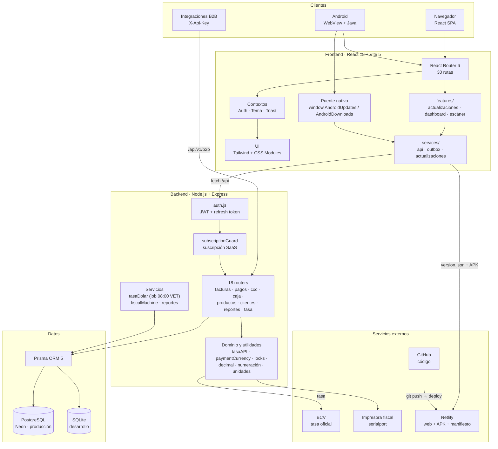
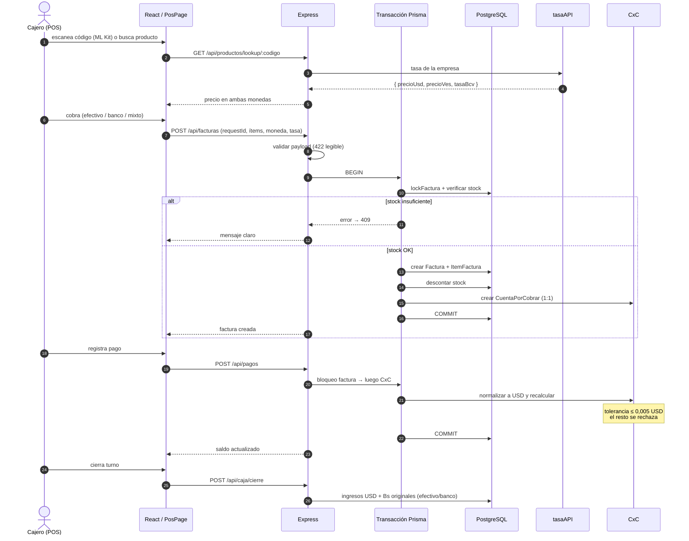
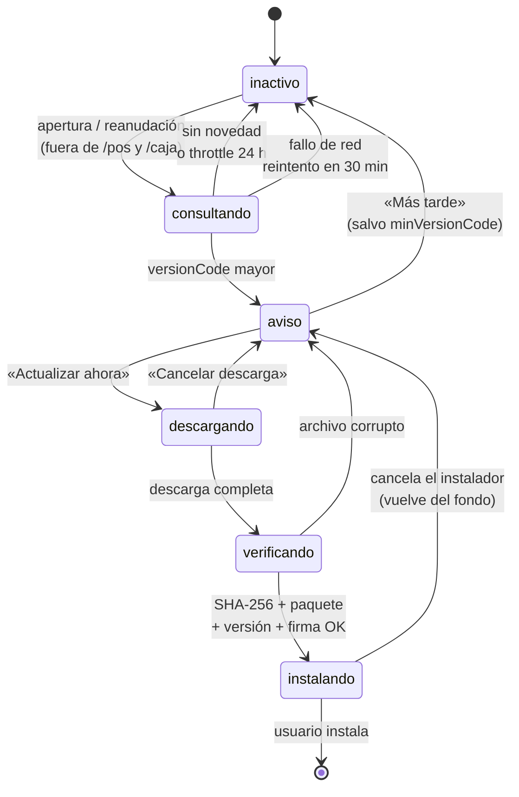
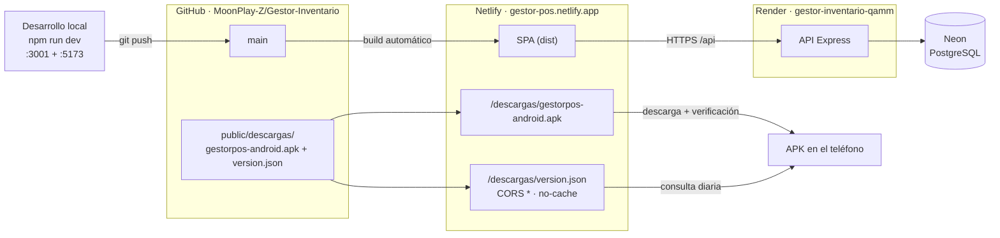
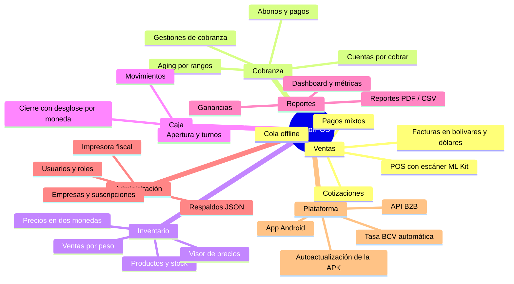

# GestorPOS — Arquitectura, tecnologías y mapa de trabajo

> Sistema POS y gestor de inventario para Venezuela.
> Documento de referencia · `main @ 345cff1` · octubre 2026

---

## 1. El sistema en una voz (monólogo)

Soy GestorPOS. Nací para resolver un problema muy concreto: una empresa venezolana
necesita vender, cobrar y saber qué tiene en el depósito **sin depender de internet
ni de una tasa de cambio que amanece distinta cada día**.

Me usan cinco clases de personas. El **Super Admin** me administra por dentro; la
**Empresa** es mi dueña y decide cómo trabajo (mi tasa, mi moneda, mis impresoras,
mis usuarios); el **Cajero** me usa de pie, con una mano, en un teléfono; el
**Inventario** me cuida el stock y los precios; el **Visor** me mira sin tocar nada.
Cada uno ve solo lo suyo: soy multi-inquilino, y la frontera es `empresaId`.

Cuando alguien vende, no improviso. Abro una transacción: verifico stock, descuento
los kilos o las unidades, calculo el total con `decimal.js` (nunca con coma flotante),
guardo la factura con un `requestId` idempotente —si el teléfono perdió la señal y el
cajero reintenta, la venta no se duplica—, bloqueo la fila con `SELECT … FOR UPDATE`
para que dos cajas no se pisen, y creo la cuenta por cobrar en el mismo acto. Si el
pago llega en bolívares sobre una factura en dólares, no me creo el número: consulto
la tasa de **esa** empresa, que es la única que manda, y normalizo todo a USD. Acepto
que falte medio centavo, porque 10 Bs nunca van a igualar exactamente 0,01 USD.

Al final del turno hago el cierre de caja y separo lo que entró en efectivo y en
banco, en dólares **y** en bolívares originales. No invento datos: si un cierre viejo
no tiene arqueo, lo dejo en nulo y lo digo.

Vivo en dos cuerpos. En la web soy una SPA de React que corre en Netlify; en el
teléfono soy la misma web dentro de un WebView de Capacitor, con cámara, pantalla
completa y descargas nativas. Mi lector de códigos usa ML Kit: enfoca, lee y devuelve
el código sin teclado ni foco. Y como no hay tienda de aplicaciones, **me actualizo
yo misma**: consulto un manifiesto, descargo la APK, verifico su SHA-256, su paquete,
su versión y su firma, y solo entonces abro el instalador. Si el usuario cancela,
vuelvo al aviso; nunca me quedo en un estado sin salida.

Sé que puedo estar dormido (Render gratuito) o apagado. Por eso la tasa del BCV se
refresca de dos maneras: un job diario a las 08:00 de Venezuela y un refresco perezoso
la primera vez que alguien me usa en el día. Si el BCV no responde, conservo la última
tasa conocida: prefiero un número viejo y honesto a uno inventado.

---

## 2. Diagrama de arquitectura



---

## 3. Flujo de trabajo: una venta completa



---

## 4. Ciclo de vida de una actualización de la APK



---

## 5. Despliegue



---

## 6. Mapa funcional



---

## 7. Tecnologías por capa

| Capa | Tecnología | Versión | Para qué |
|---|---|---|---|
| Frontend | React | 18.3 | UI por componentes |
| | Vite | 5.4 | Build y dev server (HTTPS en LAN) |
| | React Router | 6.28 | 30 rutas |
| | Tailwind CSS + CSS Modules | 3.4 | Utilidades + estilos aislados |
| | Chart.js / react-chartjs-2 | 4.4 | Gráficos del dashboard |
| | jsPDF + autotable | 4.2 | Reportes y facturas PDF |
| | Iconify | 6 | Iconografía |
| | @zxing/library | 0.21 | Lector de códigos de respaldo (web) |
| | @capacitor-mlkit/barcode-scanning | 6.2 (parcheado) | Escáner nativo 1920×1080 |
| Backend | Node.js | 20 | Runtime |
| | Express | 4.21 | 18 routers REST |
| | Prisma | 5.22 | ORM + migraciones |
| | PostgreSQL / SQLite | — | Producción / desarrollo |
| | jsonwebtoken + bcrypt | 9 / 6 | Sesión y hash de contraseñas |
| | decimal.js | 10.4 | Aritmética monetaria exacta |
| | express-rate-limit | 7 | Límite en login/registro |
| | serialport | 13 | Impresora fiscal |
| | serverless-http | 4 | Compatibilidad serverless |
| Móvil | Capacitor | 6.2 | WebView + APIs nativas |
| | Android SDK / Gradle | 8.12 | APK firmada |
| | Java | 17 | Puente nativo (3 clases) |
| | ML Kit Barcode | — | Lectura de códigos |
| | DownloadManager + FileProvider | — | Descarga e instalación de APK |
| Calidad | node:test | — | 22 pruebas del dominio del actualizador |
| | Playwright | 1.64 | E2E (Chromium, Firefox, WebKit) |
| | k6 | — | 10 escenarios de carga y concurrencia |
| Infra | Netlify | — | Web + manifiesto + APK |
| | Render + Neon | — | API + PostgreSQL |
| | GitHub | — | Código y despliegue continuo |

---

## 8. Lenguajes de programación

| Lenguaje | Archivos | Líneas aprox. | Dónde |
|---|---:|---:|---|
| JavaScript | 161 | ~35 800 | Backend, lógica de frontend, scripts, tests |
| JSX | 58 | ~17 900 | Páginas y componentes React |
| CSS | 17 | ~3 900 | Módulos, móvil, dashboard, escáner |
| SQL | 23 | ~1 300 | Migraciones Prisma + consultas `$queryRaw` |
| Java | 5 | ~1 000 | `MainActivity`, `ActualizadorApk`, `VerificadorApk` |
| HTML | 11 | ~900 | `index.html`, landing, favicon/PWA, manual |
| Python | 2 | ~300 | Generación de iconos y splash |
| Shell | — | — | `tests/k6/run.sh` |

> El proyecto no usa TypeScript como lenguaje de implementación: hay
> `typescript` en devDependencies para los tipos de React y los Page Objects de
> Playwright. El backend declara `typescript-eslint` para el lint.

---

## 9. Skills y prácticas aplicadas

### 9.1 Capacidades de ingeniería

| Skill / práctica | Dónde se ve |
|---|---|
| **SOLID + puertos y adaptadores** (pragmático) | `features/actualizaciones/`: dominio puro, caso de uso, adaptadores de red/storage/nativo |
| **Máquina de estados explícita** | `domain/maquinaEstados.js` + `puedeCerrar()`: ningún estado ocupado sin salida |
| **Pruebas del dominio sin framework** | `node --test`: 22 pruebas de manifiesto, política y estados |
| **Idempotencia** | `requestId` en facturas; reintentos del outbox no duplican ventas |
| **Concurrencia y bloqueos** | `SELECT … FOR UPDATE` con orden fijo factura → CxC; `locks.js` |
| **Precisión monetaria** | `decimal.js` en todo cálculo de dinero; helper que rechaza entrada inválida con 422 |
| **Multimoneda por empresa** | Fachada única `tasaAPI`; nunca `factura.tasaCambio` para convertir |
| **Multi-tenant** | Filtros por `empresaId` / `empresaRefId` en todos los routers |
| **Offline-first** | Outbox de ventas en el POS + reintento al recuperar red |
| **Seguridad** | JWT con `sessionVersion`, rotación de refresh tokens, rate limit, CORS acotado, `allowBackup=false` |
| **Integridad de distribución** | SHA-256 + `packageName` + `versionCode` + firma antes de instalar |
| **Diseño responsivo / móvil primero** | `movil.css`, `useMediaQuery` con detección de teléfono girado, insets reales de Android |
| **Accesibilidad y UX de error** | `FieldError`/`FormError`, estados de error con «Reintentar», mensajes Prisma traducidos |
| **Observabilidad** | `/api/health` (también usado en la cabecera del login), `AuditLog`, request id |
| **Documentación viva** | `AGENTS.md`, `docs/`, este mapa |

### 9.2 Skills del agente (OpenCode) relevantes

| Skill | Aplicación en el proyecto |
|---|---|
| `impeccable` | Rediseño móvil (login, registro, dashboard, visor, POS), jerarquía visual y estados vacíos |
| `high-end-visual-design` | Landing pública y tarjetas de marca |
| `playwright-best-practices` | `frontend/tests`: Page Object Model, `auth.setup.ts` con `storageState`, 3 navegadores |
| `opencode` | Configuración del agente (`opencode.json`, plugin de autenticación) |

---

## 10. Roles del sistema

| Rol | Alcance | Puede |
|---|---|---|
| `SUPER_ADMIN` | Global | Administrar empresas, activaciones y noticias |
| `EMPRESA` | Su empresa | Todo: usuarios, configuración, tasa, reportes, CxC, caja, respaldos |
| `CAJA` | Su empresa | POS, sus facturas, su caja, sus CxC |
| `INVENTARIO` | Su empresa | Productos, stock, precios; sin ventas ni caja |
| `VISOR` | Su empresa | Solo lectura |
| B2B | API Key | Consulta y creación acotada por `X-Api-Key` |

Los subusuarios (`CAJA`, `INVENTARIO`, `VISOR`) **no** pasan por `subscriptionGuard`:
heredan el acceso de la cuenta `EMPRESA` que los creó.

---

## 11. Comandos de trabajo

```bash
# Desarrollo
npm run dev                         # backend :3001 + frontend :5173
npm run build                       # build web (frontend/dist)

# Base de datos
npm run prisma:migrate              # migraciones
npm run prisma:seed                 # 600 productos de demo
npm run prisma:studio

# Pruebas
cd frontend && npm test             # 22 pruebas del dominio (node:test)
cd frontend && npx playwright test  # E2E
ALLOW_DESTRUCTIVE_TESTS=true node scripts/validar-flujos.js

# Publicar la APK
npm run apk:publicar -- --bump --notas "…"
```

---

## 12. Riesgos conocidos

| Riesgo | Mitigación actual |
|---|---|
| Perder la keystore | Respaldar `frontend/android/app/gestorpos-release.keystore` + `keystore.properties`; sin ella no hay actualizaciones in-place |
| APK defectuosa | Android no permite bajar `versionCode`: se corrige publicando una versión superior |
| Render dormido | Job diario + refresco perezoso de la tasa, ambos idempotentes |
| Netlify sirviendo `index.html` por el manifiesto | `version.json` real + validación de `content-type` en el cliente |
| Crecimiento del repo | ~9 MB por release en `public/descargas`; migrable a GitHub Releases |
| Cambio de dominio | `VITE_UPDATE_URL` queda incrustado en la APK: hay que mantener el dominio actual con redirección |

## 13. Arquitectura de la app móvil

La arquitectura específica de la app móvil —UI responsive, integración Android,
modo offline del POS, escáner, descargas y actualización segura de la APK— está
documentada en [ARQUITECTURA-APP-MOVIL.md](./ARQUITECTURA-APP-MOVIL.md).
