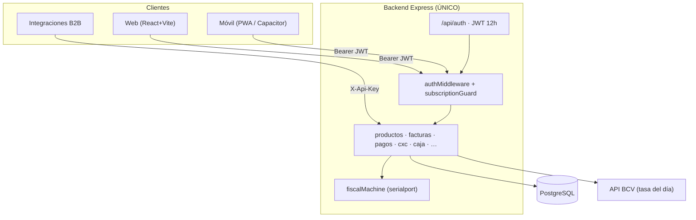
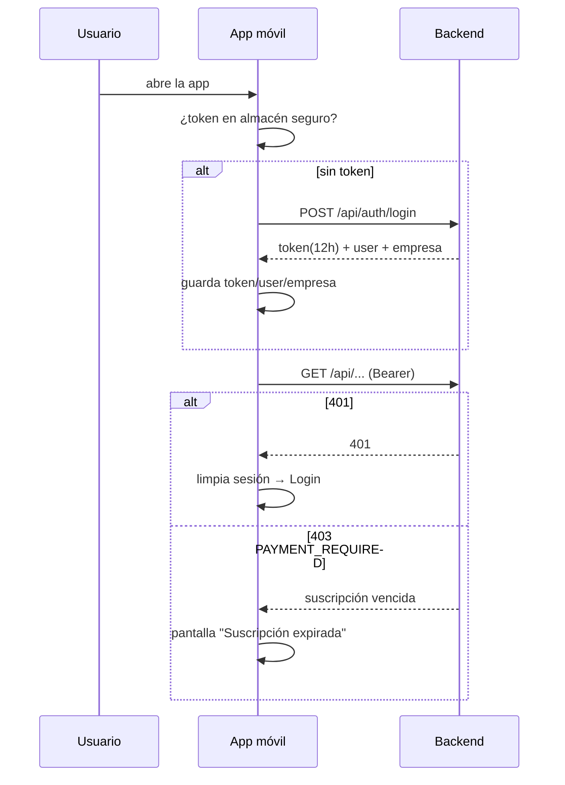
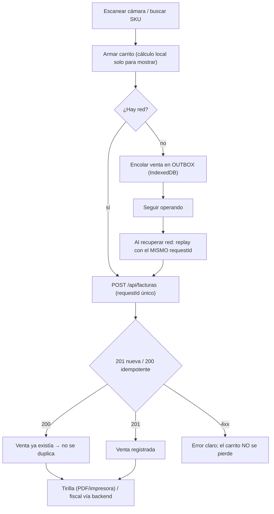
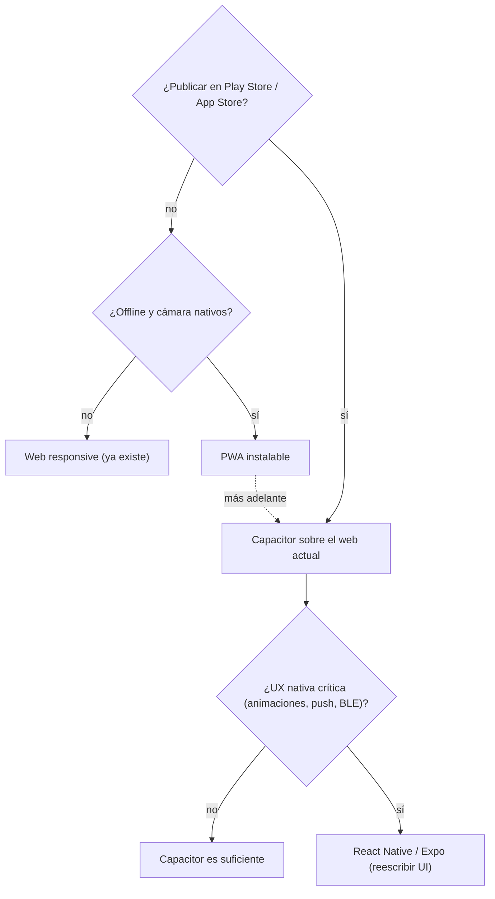

# Versión móvil de GestorPOS — análisis y decisión

**Objetivo:** una versión móvil del sistema **reutilizando el mismo backend** (Node.js + Express + Prisma). Este documento justifica la opción viable, la documenta con diagramas de flujo y define un plan por fases.

---

## 1. Punto de partida (lo que ya existe y se reutiliza)

| Pieza | Estado actual | Impacto en móvil |
|---|---|---|
| API REST única `/api` | 18 routers, ~108 endpoints, JWT + `subscriptionGuard` | **Un solo backend** sirve web, móvil y B2B |
| Frontend React+Vite | `BottomNav`, drawer móvil, breakpoints Tailwind (`md:hidden`) | Ya es usable en celular |
| `VisorPreciosPage` | Escáner con cámara (`@zxing/library`), detección `isMobile` | Pantalla móvil ya resuelta; patrón a reutilizar en POS |
| Login | `POST /api/auth/login` → `{token(12h), user, empresa}` | Reutilizable tal cual |
| Idempotencia facturas | `requestId` con branch tenant-scoped (bug 2 corregido) | **Habilita reintentos/offline sin duplicar ventas** |
| Concurrencia pagos/caja | `FOR UPDATE` + validación en tx (bugs 1, 3, 11 corregidos) | Resiste la concurrencia natural de varios móviles |
| Máquina fiscal | `serialport` en el **servidor** | El móvil no imprime fiscal; lo hace el backend/host local |
| Netlify | solo redirect SPA; falta el `/api` | El móvil debe apuntar a un backend absoluto (`VITE_API_URL`) |

**Conclusión de partida:** no hay que reescribir nada. El trabajo es *empaquetar/endurecer* el cliente web y tocar el backend de forma **aditiva**.

---

## 2. Diagramas de flujo

### 2.1 Arquitectura: un backend, varios clientes



```
            ┌──────────┐  ┌──────────┐  ┌─────────┐
            │  Web     │  │  Móvil   │  │  B2B    │
            └────┬─────┘  └────┬─────┘  └────┬────┘
                 │ Bearer JWT  │ Bearer JWT  │ X-Api-Key
                 └─────────────┼─────────────┘
                               ▼
              ┌────────────────────────────────────┐
              │   Backend Express  (sin cambios)   │
              │  auth → authMiddleware → guard      │
              │  18 routers · Prisma · tasaAPI      │
              └──────┬───────────────┬─────────────┘
                     ▼               ▼
                PostgreSQL      BCV / fiscal (serial)
```

### 2.2 Flujo de sesión en móvil



### 2.3 Flujo de venta offline-first (lo más importante en móvil)



> **Regla de oro heredada del backend:** el móvil nunca decide saldos ni conversiones. Solo muestra; el servidor es la fuente de verdad (`tasaAPI`, CxC en USD, tolerancia 0.005 USD).

### 2.4 Decisión de stack



---

## 3. Opciones evaluadas

| Criterio (1–5) | Web responsive | **PWA** | **Capacitor** | React Native/Expo |
|---|---|---|---|---|
| Reutiliza frontend | 100% | 100% | 100% | ~0% (reescritura) |
| Reutiliza backend | sí | sí | sí | sí |
| Esfuerzo inicial | 0 | **Bajo** | Medio | Alto |
| Instalable | ✗ | ✓ | ✓ | ✓ |
| Tiendas (Play/App) | ✗ | ✗ (solo "instalar" en Android) | **✓** | ✓ |
| Offline/outbox | manual | ✓ (SW+IndexedDB) | ✓ | ✓ |
| Cámara / barcode | ✓ (ya en Visor) | ✓ | ✓ (plugins nativos) | ✓ |
| Push | ✗ | limitado (iOS) | ✓ | ✓ |
| Mantenimiento | 1 base | **1 base** | 1 base + config nativa | **2 bases divergentes** |
| Coste operativo | bajo | bajo | medio | alto |

---

## 4. Opción viable recomendada

**PWA primero, con Capacitor como escalón natural. Descartar React Native.**

**Por qué:**
1. El frontend **ya es responsive** (BottomNav, drawer, Visor con cámara). El ROI está en *empaquetar*, no en reescribir.
2. El backend ya tiene lo difícil: idempotencia (`requestId`), concurrencia con locks y multimoneda centralizada. Una app móvil **comparte esos contratos sin cambios**.
3. React Native duplicaría toda la capa de UI (28 páginas) y crearía dos bases que derivan — justo lo que `AGENTS.md` evita (fuente única de tasas/paginación/decimales).
4. Venezuela/retail: la instalación silenciosa por link (PWA) y el escaneo con cámara ya funcionan; si luego se necesita Play Store o push real → **Capacitor reusa el 100% del código** y añade plugins nativos sin reescribir pantallas.

**Cuándo saltar a Capacitor:** publicación en tiendas, impresión Bluetooth, push, lectura BLE, acceso a almacenamiento seguro nativo.

**Cuándo (y solo entonces) React Native:** producto móvil claramente distinto del web, con equipo dedicado y UX nativa intensiva. Hoy no aplica.

---

## 5. Cambios en el backend: mínimos y aditivos

| Cambio | Tipo | Por qué |
|---|---|---|
| CORS: incluir orígenes del móvil (`ALLOWED_ORIGINS`) — PWA y, si aplica, `capacitor://localhost` / `https://localhost` | aditivo (env) | Sin esto, el binario Capacitor no llama a `/api` |
| `POST /api/auth/refresh` (opcional) | aditivo, usa `sessionVersion` | Evita relogin cada 12 h; hoy el token expira y el móvil pierde sesión |
| `GET /api/health` ya existe | — | Keep-alive y *gate* de conectividad del outbox |
| Nada más | — | facturas/pagos/cxc/caja/tasa ya exponen lo necesario |

**No tocar:** esquema de tasas, `pagoCxcAUsd`, tolerancia 0.005 USD, locks, `facturasPrismaTenantFilter`. El móvil consume, no recalcula.

---

## 6. Riesgos y mitigaciones

| Riesgo | CWE/OWASP | Mitigación |
|---|---|---|
| Offline calcula saldos mal y sobrepaga | API6 | Cliente **no** calcula saldo; envía pago, backend valida en tx + tolerancia |
| Duplicar ventas al reintentar | API6 | Reusar el **mismo `requestId`** (idempotencia ya corregida, tenant-scoped) |
| Token 12 h en campo | API2 | Refresh opcional o *biometric re-login*; guardar en almacén seguro |
| `localStorage` evictable en móvil | API8 | Outbox y token en IndexedDB / SecureStorage, no en `localStorage` |
| Cámara iOS requiere HTTPS | — | PWA en HTTPS (Netlify ya lo es) o plugin nativo en Capacitor |
| Impresión fiscal desde móvil | — | Fiscal sigue en **servidor**; el móvil solo dispara `POST /api/fiscal/imprimir/:id` si el host local está accesible |
| Timeout 20 s en red mala | — | Bajar a ~10 s + backoff con reintento idempotente |

---

## 7. Plan por fases

| Fase | Entregable | Estado | Gate de aceptación |
|---|---|---|---|
| **M0 – Endurecer responsive** | Corregir tabs táctiles, teclado numérico en montos, safe-areas iOS | **✅ hecho** | Lighthouse móvil ≥ 90 |
| **M1 – PWA** | `manifest.webmanifest`, service worker (app shell), iconos, instalable | **✅ hecho** | Instala en Android/iOS; abre sin red (shell) |
| **M2 – Escáner móvil en POS** | Reusar `@zxing/library` de `VisorPreciosPage` en `PosPage` | **✅ hecho** | Escanear → agrega línea en < 1 s |
| **M3 – Outbox offline** | Cola IndexedDB + replay con mismo `requestId` + reintentos | **✅ hecho** | Escenario k6 offline: N ventas → 0 duplicados, 0 sobrepagos |
| **M4 – Sesión móvil** | Refresh token (aditivo) + reintento 401 con renovación | **✅ hecho** | Sesión > 12 h sin perder datos |
| **M5 – Capacitor (si hay tiendas)** | APK/IPA, plugins cámara/storage, CORS de orígenes nativos | **✅ hecho** | Publica en Play interno |
| **M6 – Observabilidad móvil** | Métricas outbox (encoladas/sincronizadas/fallidas) | **✅ hecho** | Dashboard de sincronización |

**Validación:** extender `tests/k6` con un escenario `11-movil-offline` que replay-ee el mismo `requestId` y verifique (vía `verify.js`) que no hay ventas duplicadas ni CxC descuadradas — el arnés ya cubre estos invariantes.

---

## 8. Recomendación final

> **PWA sobre el frontend actual + backend intacto**, con **Capacitor** reservado para el día que se necesite Play Store/push/Bluetooth, y **React Native descartado** por duplicar la UI. El backend no requiere cambios de lógica: solo CORS (env) y, opcionalmente, un endpoint de refresh. La idempotencia y el control de concurrencia asegurados (bugs 1, 2, 3, 11) son precisamente lo que hace segura una app móvil con reintentos y trabajo offline.

---

## Anexo A — Entregables de la Fase M1 (PWA)

| Archivo | Rol |
|---|---|
| `frontend/public/manifest.webmanifest` | Manifiesto: nombre, iconos, tema, atajos (Vender/Cobrar/Stock) |
| `frontend/public/sw.js` | Service worker: shell offline, cache-first estáticos, `/api` siempre red |
| `frontend/public/pwa-192.png`, `pwa-512.png`, `pwa-maskable-512.png`, `apple-touch-icon.png` | Iconos generados sin dependencias |
| `frontend/scripts/gen-pwa-icons.cjs` | Generador de iconos (PNG por `zlib` nativo) |
| `frontend/index.html` | `<link rel="manifest">`, `theme-color`, metas apple/mobile-web-app |
| `frontend/src/main.jsx` | Registro del SW solo en producción |

### Fase M2 — Escáner de cámara en POS

| Archivo | Rol |
|---|---|
| `frontend/src/hooks/useBarcodeScanner.js` | Hook reutilizable: cámara (prefiere trasera), decodificación ZXing, errores legibles, limpieza al desmontar |
| `frontend/src/pages/VisorPreciosPage.jsx` | Refactorizado para consumir el hook (misma fuente de verdad) |
| `frontend/src/pages/PosPage.jsx` | Botón "Escanear con cámara" + modal con `<video>`, retícula y fallback a `API.lookupProducto` → `addToCart` |

### Fase M3 — Outbox offline

| Archivo | Rol |
|---|---|
| `frontend/src/services/outbox.js` | Cola IndexedDB (`gestorpos-offline`), `encolarVenta` (reutiliza `requestId`), `obtenerPendientes`, `syncOutbox` (FIFO, reintenta solo errores de red, 4xx = fallo permanente, máx. 5 intentos) |
| `frontend/src/pages/PosPage.jsx` | Fallback offline en `handleEmitirFactura` (guarda en outbox si `status===0`/`NETWORK_ERROR`), indicador "Sin conexión / N por sincronizar", auto-sync en evento `online`, recibo al sincronizar vía evento `outbox:synced` |

**Seguridad:** reintentar es seguro porque el backend es la fuente de verdad — el `requestId` devuelve la MISMA factura (idempotencia) y los locks/`pagoCxcAUsd` evitan sobrepagos. El cliente nunca calcula saldos.

### Fase M4 — Sesión móvil (refresh token)

| Archivo | Rol |
|---|---|
| `backend/prisma/schema.prisma` | `Usuario.refreshTokenId String?` (aditivo) |
| `backend/prisma/migrations/20261019120000_add_usuario_refresh_token_id/` | Migración aditiva: columna nullable |
| `backend/src/routes/auth.js` | `signAccessToken`/`signRefreshToken` (claim `type`); login emite access (12h) + refresh (7d deslizante); `POST /auth/refresh` con rotación + detección de reuso |
| `backend/src/middleware/auth.js` | Rechaza un refresh token usado como access token |
| `frontend/src/services/api.js` | `setRefreshToken`, `refreshAccessToken` (dedup de refreshes concurrentes), reintento 401 con renovación |
| `frontend/src/context/AuthContext.jsx` | Guarda/limpia el refresh token; refresco proactivo al montar |
| `frontend/src/pages/LoginPage.jsx`, `RegisterPage.jsx` | Pasan `refreshToken` a `loginUser` |

**Diseño:** access token JWT 12h + refresh token JWT 7d (deslizante: cada renovación emite uno nuevo). El refresh **rota** (nuevo `jti`, el viejo queda inservible) y tiene **detección de reuso**: si un token viejo vuelve a usarse, se revoca la sesión (`sessionVersion++`). Sin refresh token válido → re-login. Validado con 7 casos (login, refresh, rotación, reuso, separación de tokens).

### Fase M5 — Capacitor (app nativa)

| Archivo | Rol |
|---|---|
| `frontend/capacitor.config.json` | `appId`, `appName`, `webDir: 'dist'`, `allowMixedContent` (dev local) |
| `frontend/.env.capacitor` | `VITE_API_URL` del backend (dev: localhost:3001; prod: Render) |
| `frontend/package.json` | Scripts `build:capacitor`, `cap:sync`, `build:android`, `build:ios` |
| `frontend/android/`, `frontend/ios/` | Proyectos nativos generados por `cap add` |
| `backend/src/app.js` | CORS: `https://localhost` y `capacitor://localhost` permitidos |

**Build web → nativo:** `npm run build:capacitor` → `vite build --mode capacitor && cap sync` (empaqueta `dist/` en ambas plataformas). Verificado: `VITE_API_URL` embebida, assets copiados a `android/` e `ios/`, CORS preflight 204 para orígenes nativos.

### APK de Android (verificado)

Cadena de herramientas necesaria (Linux):

| Componente | Versión | Nota |
|---|---|---|
| JDK | 21 (`/usr/lib/jvm/java-21-openjdk-amd64`) | Gradle 8.2.1 no corre en Java 21 → wrapper subido a **8.12** |
| Gradle wrapper | 8.12 | `android/gradle/wrapper/gradle-wrapper.properties` |
| Android SDK | `platforms;android-34` + `build-tools;34.0.0` | vía `sdkmanager` (cmdline-tools) |
| AGP | 8.2.1 | sin cambios |
| `android/local.properties` | `sdk.dir=/home/juan/Android/Sdk` | gitignored |

**Generar el APK:**
```bash
cd frontend
npm run build:capacitor      # vite build --mode capacitor && cap sync
cd android && ./gradlew assembleDebug
# → android/app/build/outputs/apk/debug/app-debug.apk
```

**Resultado:** `app-debug.apk` **4,3 MB**, `com.gestorpos.app`, label `GestorPOS`, minSdk 22 / targetSdk 34, `BUILD SUCCESSFUL` (134 tareas).

**Instalar en el teléfono:** `adb install -r android/app/build/outputs/apk/debug/app-debug.apk`.

**iOS:** requiere macOS/Xcode; en Linux solo se genera el proyecto (`ios/App/`). Producción: apuntar `VITE_API_URL` al backend desplegado (HTTPS) y quitar `allowMixedContent`.

### Fase M6 — Observabilidad del outbox

| Archivo | Rol |
|---|---|
| `frontend/src/services/outbox.js` | `obtenerTodos()`: historial completo del outbox (todos los estados), más reciente primero |
| `frontend/src/pages/PosPage.jsx` | Botón "Historial" en el indicador + modal con cada venta (tipo, ítems, fecha, `facturaId`, estado y error) |

**Qué da:** visibilidad del outbox sin backend de métricas — el cajero ve `PENDING / SYNCING / SYNCED / FAILED`, la fecha, la factura asignada y el motivo de cualquier fallo. Complementa el indicador "N por sincronizar" de la Fase M3.

**Verificación:** `npm run build` → `dist/` contiene `manifest.webmanifest`, `sw.js` y los iconos; `index.html` referencia el manifest.
